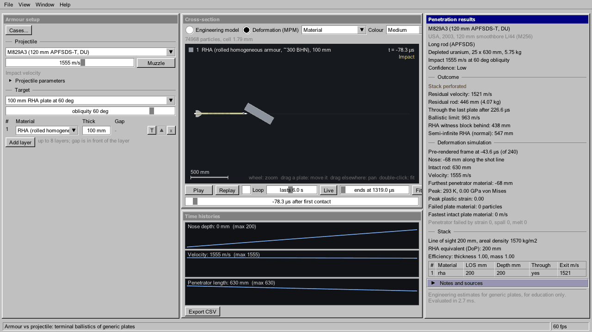

# Spall

<p align="center"></p>

<p align="center"></p>

A Windows scientific viewer of armour vs projectile terminal ballistics: one projectile (long rod,
compact AP shot, shell, missile or shaped-charge jet) against a stack of generic plates, with an
animated cross-section, an optional GPU deformation simulation and time histories.

Spall was called BlastView until October 2026. Earlier versions also had an explosion viewer, a
fireball and blast-wave simulator; it was removed then and lives on in the git history.

C++20, OpenGL 4.6 (compute shaders), GLFW 3.5.1, Dear ImGui 1.92.9. The UI imitates Windows 95
"Classic" (default) or Windows XP "Luna".

## Status and limits

Spall is an educational tool, not a design or certification tool. Read its numbers as estimates.

- The engineering model is one-dimensional along the shot line: no ricochet or nose reflection, and
  the plate angle is clamped at 80 degrees. Above about 70 degrees its verdict (perforated,
  residual velocity) is outside what the model can say; the deformation view is the better guide.
- The deformation view is two-dimensional plane strain with generic material constants. A round rod
  is a slab, a perforated plate shows as a row of slots, and ballistic gelatin has no rate
  hardening or cavitation.
- The two views can disagree: the M993 carbide-core rod shatters in the deformation view but
  perforates in the engineering model.
- Catalogue values come from open sources, each entry with a confidence. Some explosive fillers
  have no source yet and are marked as estimates.
- Tested on one machine (an NVIDIA RTX 5070 Ti). AMD and Intel GPUs should work but are untested,
  and the free-video-memory query is NVIDIA only.
- The Windows build is unsigned, so SmartScreen warns the first time it runs.

## Download

Release zips are on the GitHub Releases page: unzip anywhere and run `Spall.exe`; there is nothing
to install. Release notes are in `docs/release/`.

## Requirements

- Windows 10 or 11, 64-bit.
- A GPU with OpenGL 4.6 drivers (any current NVIDIA, AMD or Intel GPU). The replay checkpoints used
  for scrubbing are skipped when they do not fit in the free video memory. The deformation view's
  Ultra, Insane and Ludicrous levels need several GB of video memory and step far slower than real
  time (tens of minutes to pre-render a long shot); Insane and Ludicrous are best pre-rendered. A
  level too big for the video memory keeps its grid there and puts the rest of its particles in
  system memory (up to 60 % of what is free; the "System RAM" box turns this off), streaming them
  through the card every step: the CPU adds room, not speed, and each gigabyte spilled costs
  roughly 70 to 150 ms a step (117 ms measured). A level that fits neither gives way to the next
  one down and the app says why. Ludicrous (83 million particles at the grid it can hold, 12 GB)
  loads in under 10 s and runs entirely in video memory on a 16 GB card at about 0.11 s a step,
  or about 0.77 s a step with half of it in system memory on an 8 GB card. At a 10 ns step that
  is about 100 000 steps for each millisecond of shot, so it is an overnight tier (a 3 ms shot is
  roughly 9 hours on the 16 GB card), and its pre-render keeps only some of the particles in each
  frame.
- To build: Visual Studio 2022 (or the Build Tools) with the "Desktop development with C++"
  workload. `build.bat` finds it with `vswhere`. No CMake and no package manager: GLFW and ImGui
  are vendored in `third_party/`.
- Optional: Python 3, only to regenerate `data/*.json` with the scripts in `tools/`.

## Build

From a Command Prompt or PowerShell in the repository folder:

```bat
build.bat release app     :: build\release\Spall.exe
build.bat release test    :: build\release\SpallTests.exe
build.bat release all     :: both (the default)
build.bat dist app        :: build\dist\Spall.exe with the C runtime linked in (the release zip)
build.bat debug app       :: debug build in build\debug
build.bat clean
```

Third-party libraries are compiled once per configuration and cached.

## Run

Double-click `build\release\Spall.exe`, or run it from a terminal. Data and shaders are found by
walking up from the exe's folder to the folder that contains `data\projectiles.json` and `shaders\`,
so the exe can stay in `build\release`.

Settings (theme, window position, and the deformation view's colour, quality and mounts) are
saved to `spall.ini` next to the data folder on exit. Delete it to restore the defaults.

### Controls

| Input | Action |
|---|---|
| F12 | Screenshot to `screenshots\` |
| Alt+F4 | Quit |

In the armour cross-section: wheel zooms, drag pans, double-click fits the view. Switch the view
between **Engineering model** and **Deformation (MPM)** above it; the deformation view has colour
and quality settings and adds simulated readouts to the results panel. The time slider scrubs the
deformation view in both directions at any speed: a live run keeps up to 32 checkpoints of the
simulation and goes back to the one before the time you drag to (steps on from there), and a
pre-rendered run plays any frame at once.

Cases... (top of the setup panel) saves the projectile, penetrator, obliquity, velocity and layers
under a name in `cases\` next to the data folder and loads them back. Export CSV (in the history
panel) writes the time histories to `exports\` as CSV, plus the deformation readouts when that
view has run. There is no file dialog: names are typed and the folders are fixed.

### Command line

| Option | Effect |
|---|---|
| `--theme classic\|luna` | Override the saved theme |
| `--projectile <id>`, `--preset <id>`, `--at 0..1` | Armour case, and the fraction of the event to show |
| `--obliquity <deg>` | Armour plate angle (negative leans the plates the other way) |
| `--armour-mpm [--mpm-colour <mode>]` | Start in the deformation view; mode is `material`, `stress`, `strain`, `temperature`, `speed` or `failure` |
| `--prerender` | Pre-render the deformation animation first, so it plays at any speed |
| `--mpm-quality low\|medium\|high\|ultra\|insane\|ludicrous` | Deformation view quality (8, 14 or 22 cells per rod diameter; ultra, insane and ludicrous seed up to 4, 12 and 100 million particles, for slow motion and pre-render; insane and ludicrous are best pre-rendered) |
| `--mpm-soft-mounts` | Deformation view with soft mounts: each plate's edge strip is tied to its rest position by a damped spring instead of clamped, so the mounting gives and rings (also the Soft mounts box in the toolbar) |
| `--capture <png> [--size WxH] [--frames N]` | Render N frames (default 90) of the full UI off screen, save a PNG and exit |
| `--selftest mpm` | Headless GPU check of the deformation solver |
| `--gl-info` | Print the OpenGL context and exit |

## What is modelled

A short summary; [docs/physics.md](docs/physics.md) has the equations, constants and limits.

- **Data.** Projectiles, armour materials and explosive fillers are JSON catalogues in `data/`, each
  entry with its sources and a confidence. Filler properties (density, detonation velocity, oxygen
  balance, soot and afterburn energy) come from `tools/compute_explosives.py`.
- **Armour.** Long rods: Tate–Alekseevskii integrated in time, calibrated to Lanz–Odermatt.
  Compact AP: de Marre limit velocity with Lambert–Jonas residuals. Shaped charges: jet elements
  stretching from a virtual origin until breakup, each penetrating hydrodynamically against the
  target resistance; broken particles drift off axis. Obliquity, spaced plates and
  ceramics (as confined) are handled; results are engineering estimates.
- **Deformation (MPM).** An optional view of the armour cross-section in which the rod or shot
  and the plates are simulated on the GPU as deformable material (2D plane-strain MLS-MPM,
  Johnson–Cook plasticity, heating, failure by strain, spall or melting). It shows rods
  mushrooming and eroding, plates bulging, flexing and breaking up, and debris. Long rods are
  drawn as a generic fin-stabilised dart (light-alloy cap, swept fins, tracer). It can colour by
  material, von Mises stress, plastic strain, temperature, speed or failure mode. Depths are
  indicative because a 2D slab stands in for the round rod. Generic reactive tiles
  (sheet explosive between two thin plates, preset "Generic reactive tiles") are three separate
  blocks you can drag apart or off the shot line (the T button opens the tiles popup: width, gap,
  offset, block count); the one hit lights under the impact and its neighbours stay put; the detonation runs through the sheet and its products, drawn as fire and smoke, drive
  the plates apart. Hot metal glows by its temperature. Ceramics fracture and comminute (JH-2
  strength), rubber-like elastomers stretch and bulge, and fibre laminates (aramid, UHMWPE)
  delaminate into sliding plies whose fibres break; presets "Generic bulging tiles" and
  "Ceramic on composite backing" show them. Ballistic gelatin (a 10 % gelatin soft test
  medium) comes as a free block you can drag, and a thin 2024 aluminium witness sheet sits
  behind the armour (presets "Ballistic gelatin block", "Witness sheet: 12 mm RHA..." and "12 mm RHA, 150 mm
  gap, 1.5 mm witness sheet, 100 mm gap, gelatin block"); both are plain material blocks that show how a plate or a soft medium
  flows, tears and perforates, with no body model and no damage readouts. More presets of free pieces and thin sheets: "Slat screen", "Bar screen",
  "Sloped glacis", "Perforated plate" and "Witness stack" (three sheets behind a plate). Hard cores, carbide, cap and case steel are
  brittle: a flawed grain fails in tension and the piece shatters, while a tough rod still
  mushrooms (a 30 mm APFSDS against 600 mm of RHA mushrooms and stops short of it). Missiles
  are seeded whole and come apart on impact: a thin nose shell round the fuze, the warhead
  case and filler, a thin motor tube with its nozzle plate round a bored propellant grain that
  crumbles, and fins. Plates are clamped at their edges by default; `--mpm-soft-mounts` ties
  the edge strip to its rest position with a damped spring so the mounting gives and rings. Shaped charges run as a stretching copper particle
  stream that breaks up into segments on the engineering model's schedule and erodes the plates
  (try "Generic 80 mm shaped charge"); its liner collapse is not simulated. The view reports
  material state only: for a thin witness sheet behind the armour, "Read the sheets" in the
  readouts gives the hole width, the bulge and the speed of the penetrator once past it.

Everything is an educational approximation: the engineering model is one-dimensional along the shot
line (no ricochet or nose reflection; the angle is clamped at 80 degrees), and the deformation
simulation is two-dimensional plane strain with generic material constants.

## Data policy

- Outputs are physical quantities only: penetration depth, residual velocity and similar plate
  figures.
- **No damage, lethality, casualty or targeting outputs**, and no vulnerability of vehicles,
  structures or people. The viewer models generic plates and plate stacks only.
- Catalogue values come from open sources (mostly Wikipedia and the sources it cites, FAS,
  GlobalSecurity). Each entry lists its sources and a `confidence` of high, medium or low; figures
  that could not be confirmed are marked as estimates.

## Repository layout

```
data/        projectiles, explosive fillers, armour materials (JSON)
tools/       Python scripts that generate data/*.json
shaders/     mpm/ (deformation solver and renderer), common/
src/app/     main loop, armour workspace, settings, selftest
src/ui/      Classic/Luna theme, widgets
src/sim/     MPM scene, solver and pre-rendered frames, armour run
src/render/  deformation view, snapshots, blackbody LUT, colour maps
src/physics/ penetration models, MPM material model, projectile shapes, fuzes
src/data/    JSON catalogue loaders
tests/       unit tests (CPU only)
res/         the exe icon (generated by docs/brand/make_logo.py) and its resource script
docs/        physics notes, brand files, release notes
```

## Licences

Spall is released under the MIT licence (see `LICENSE`). GLFW (zlib/libpng) and Dear ImGui (MIT)
are vendored unmodified in `third_party/`; see `third_party/VERSIONS.txt`.
and yes its made with ai.
